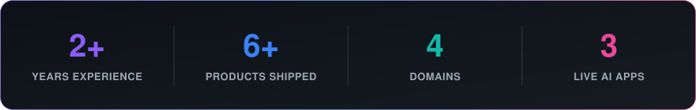
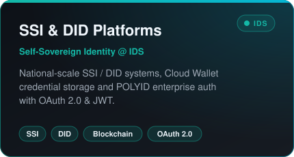

<!-- ══════════════════════════════════════════════════════════════════════
  🧠 HARSH PATWARE — Full Stack • AI Solutions • Web3 • SSI
     GitHub Profile README v2
══════════════════════════════════════════════════════════════════════ -->

<!-- ─── HEADER ─── -->
<div align="center">
  
</div>

<div align="center">
  <a href="https://git.io/typing-svg">
    
  </a>
</div>

<div align="center">
  <a href="https://harsh-patware-dev.vercel.app/"></a>
  <a href="https://www.linkedin.com/in/harsh-patware-78923a253"></a>
  <a href="mailto:harshpatware1505@gmail.com"></a>
  <br/>
  
  <a href="https://github.com/patware887?tab=followers"></a>
  
  
</div>

<!-- ─── QUICK NAV ─── -->
<p align="center">
  <a href="#-about-me"><b>About</b></a> •
  <a href="#-experience--impact"><b>Experience</b></a> •
  <a href="#-tech-arsenal"><b>Stack</b></a> •
  <a href="#-featured-ai-projects"><b>Projects</b></a> •
  <a href="#-github-analytics"><b>Stats</b></a> •
  <a href="#-lets-connect"><b>Connect</b></a>
</p>


## 🧠 About Me

```python
class HarshPatware:
    """
    🧠 An AI-augmented Full Stack Engineer who bridges the gap
       between intelligent systems and production-grade software.
    """

    def __init__(self):
        self.name       = "Harsh Patware"
        self.role       = "Full Stack SDE @ Information Data Systems"
        self.portfolio  = "https://harsh-patware-dev.vercel.app"
        self.location   = "Indore, India 🇮🇳"
        self.education  = "B.Tech CSE — Medi-Caps University"
        self.domains    = ["EdTech", "Blockchain/DID", "AI/LLM", "Web3/SSI"]

        self.currently = {
            "building":   "AI-native SaaS at enterprise scale 🚀",
            "shipping":   "Production apps used by govt & enterprise",
            "learning":   "Agentic AI, Multi-modal LLMs & MLOps",
            "exploring":  "AI Agents, MCP, RAG & Vector Databases",
            "open_to":    "Collaborations on AI-powered open source",
        }

    def mission(self):
        return "Turn complex AI research into products real people use."

print(HarshPatware().mission())
```

<div align="center">

| 🧠 What I Do | 🎯 Current Focus |
|:--|:--|
| Architect **AI-powered full-stack systems** end to end | Building **AI-native SaaS** at enterprise scale |
| Design **RAG pipelines** & LLM-powered applications | Exploring **Agentic AI & autonomous systems** |
| Build **production platforms** across Blockchain, AI & EdTech | Scaling **Self-Sovereign Identity** systems |
| Engineer **Web3 & SSI / DID** identity infrastructure | Shipping **national-scale** govt & enterprise products |
| Ship **pixel-perfect UIs** with immersive animations | |

</div>


## 🏢 Experience & Impact

<table>
<tr>
<td width="140" align="center"><b>Jul 2024</b><br/>→ Present</td>
<td>

**🔷 Full-Stack SDE** · Information Data Systems (IDS)
- Building enterprise platforms across **Education, Blockchain & Identity**
- Leading dev of multiple **production-grade platforms shipped at national scale**
- 🎓 India's first **educational metaverse** · ⛓️ **National blockchain infrastructure** & SSI systems

</td>
</tr>
<tr>
<td align="center"><b>2022</b><br/>→ Jun 2024</td>
<td>

**🔹 Frontend Intern → Full-Stack** · IDS
- Grew from intern to full-stack across client projects, dashboards & web platforms

</td>
</tr>
<tr>
<td align="center"><b>2018</b><br/>→ 2022</td>
<td>

**🎓 B.Tech CSE** · Medi-Caps University

</td>
</tr>
</table>

<p align="center"></p>


## 🛠 Tech Arsenal

<div align="center">

| Layer | Stack |
|:--:|:--|
| 🤖 **AI / LLM** |        |
| ⚛️ **Frontend** |    |
| ⚙️ **Backend** |    |
| 🗄️ **Data & Vectors** |    |
| ⛓️ **Blockchain** |      |
| ☁️ **DevOps** |  |

</div>


## 🧬 AI Development Philosophy

<div align="center">

| 🎯 Problem | 🧠 AI Solution | 🚀 Impact |
|:--|:--|:--|
| Users need instant answers | RAG + LLM pipeline with vector search | Instant, accurate responses |
| Complex docs, hard to search | TF-IDF embeddings + Groq ultra-fast LLM | Cited, grounded answers |
| Slow manual code reviews | AI code-review agent + scoring | Bugs caught in seconds |
| Static UIs | AI-powered personalization | Higher user engagement |
| Scale issues | Microservices + cloud architecture | Enterprise-grade apps |

</div>


## 🌟 Featured AI Projects

<p align="center">
  <a href="https://harsh-patware-dev.vercel.app/"></a>
  <a href="https://harsh-patware-dev.vercel.app/projects/rag-app"></a>
</p>
<p align="center">
  <a href="https://harsh-patware-dev.vercel.app/projects/stock-assistant"></a>
  <a href="https://harsh-patware-dev.vercel.app/projects/code-review"></a>
</p>

<details>
<summary>🔐 <b>Enterprise Work @ IDS</b> — National-Scale Platforms (Confidential)</summary>
<br/>

- 🎓 India's first **educational metaverse** platform
- ⛓️ **National blockchain infrastructure** for government
- 🆔 **Self-Sovereign Identity (SSI)** & DID systems
- 🔐 **POLYID** — Enterprise auth dashboard with OAuth 2.0, JWT & identity lifecycle
- ☁️ **Cloud Wallet** — Digital asset management & credential storage at scale

**Domains:** EdTech · Blockchain · Identity · Cloud — production platforms used across government & enterprise.

</details>


## 📊 GitHub Analytics

<div align="center">
  
  <br/><br/>
  
</div>


## 🤝 Let's Connect

<div align="center">

**Building something with AI, identity or Web3? Let's talk.**

<a href="https://harsh-patware-dev.vercel.app/"></a>
<a href="https://www.linkedin.com/in/harsh-patware-78923a253"></a>
<a href="mailto:harshpatware1505@gmail.com"></a>

<br/><br/>

> *"The best way to predict the future is to build it — and teach a model to optimize it."*
> — **Harsh Patware** 🧠


</div>


